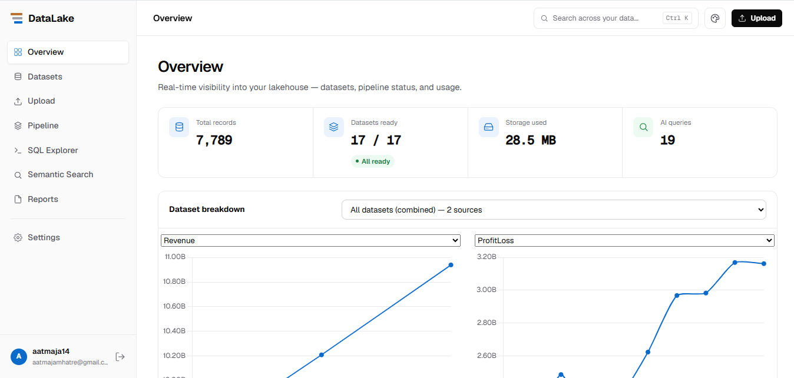
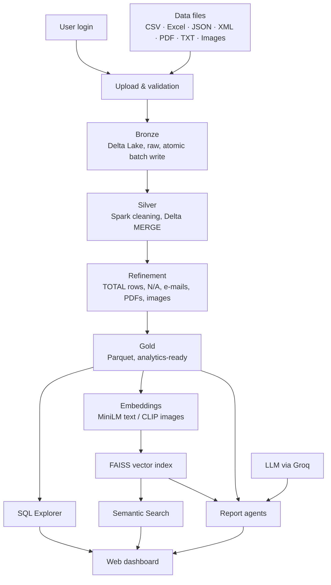
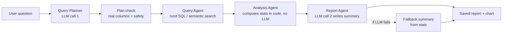
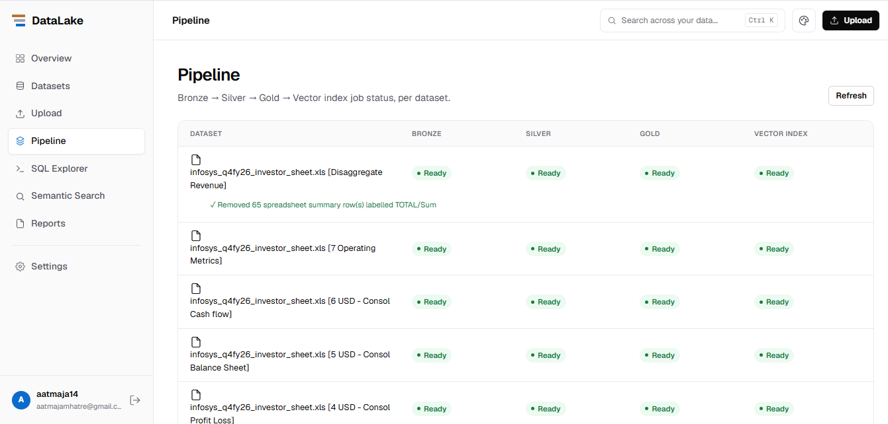
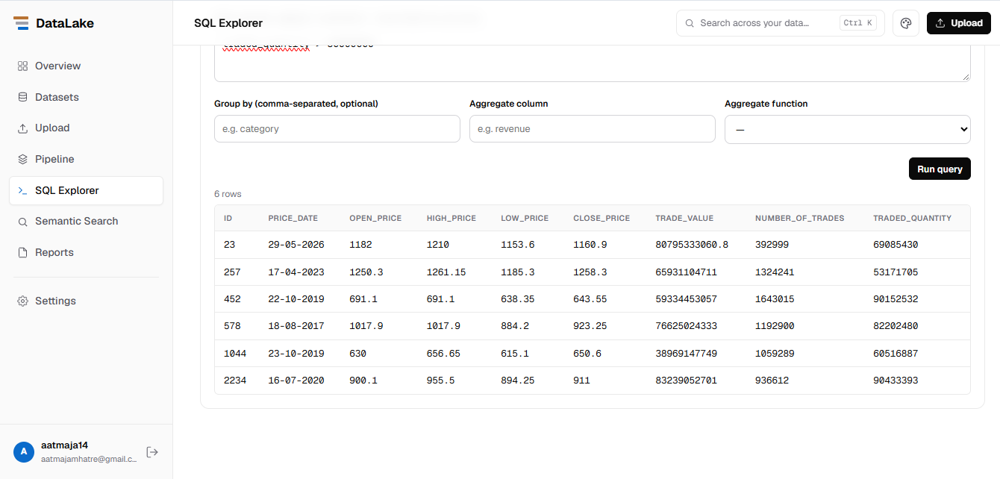
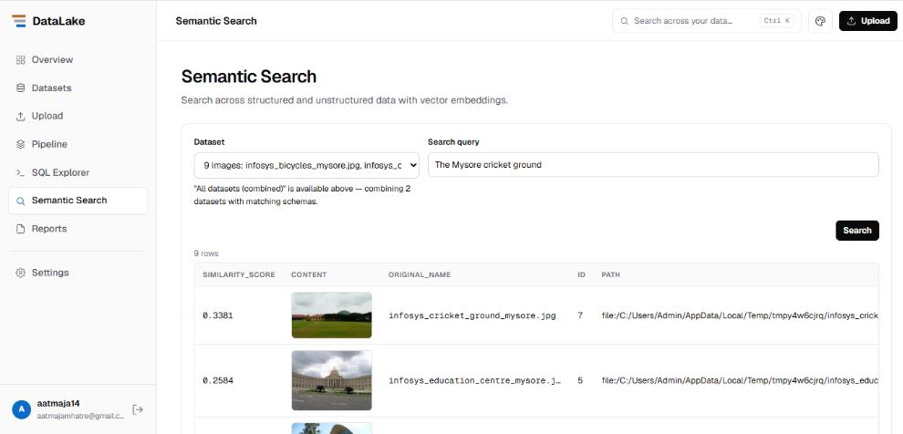
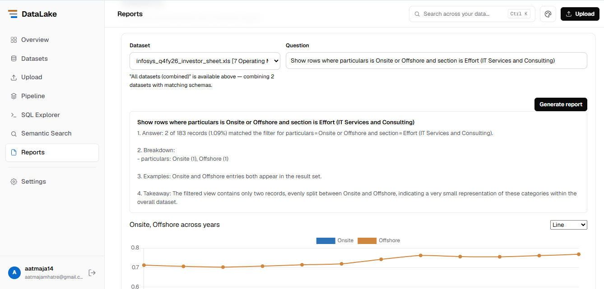

# AI-Enhanced Data Lakehouse

**Upload any file — spreadsheets, JSON, PDFs, raw e-mails, images — and query it three ways: a SQL explorer, search by meaning, and plain-English AI reports where every number comes from the data, not the LLM.**

Built on **Apache Spark + Delta Lake** using the **medallion architecture** (Bronze → Silver → Gold), with **FAISS** vector search, **MiniLM / CLIP** embeddings, and an **agent-based report pipeline** powered by an LLM. Runs entirely on a single laptop with open-source tools.

> B.Tech final-year project (Project B), Electronics & Computer Science, Pillai College of Engineering, 2026–27
> Team: Siddhi Pandhere, Aatmaja Mhatre, Bhavesh Patil · Guide: Dr. Ravi Biradar



---

## Why this exists

Real data is messy and scattered across formats. Warehouses handle tables but not PDFs or photos; data lakes accept anything but become hard to trust and query. And when you ask an LLM a question about your data, it can confidently invent numbers.

This project fixes both problems:

- **One pipeline for every format.** Files are ingested, cleaned and refined automatically — no hand-written ETL per dataset.
- **AI that can't make up figures.** The LLM only plans the query and words the answer. All counts, percentages and statistics are computed in code from the actual rows.

---

## Features

| Feature | What it does |
|---|---|
| **Bulk upload** | Up to 25 files per batch (≤ 200 MB each): CSV, Excel, Parquet, JSON, XML, PDF, TXT, PNG, JPG. Every file is validated before anything is saved — one bad file rejects the whole batch. |
| **Automatic medallion pipeline** | Bronze → Silver → Gold → Vector index runs in the background after upload, with per-stage status and a Retry button. |
| **Automatic data cleaning** | Converts numbers stored as text, derives discount % from labels like `"69% off"`, treats `N/A` / `NaN` as missing, removes spreadsheet TOTAL rows, splits raw e-mails into fields, removes duplicate e-mails. Every fix is logged on the Pipeline page. |
| **SQL Explorer** | Filter, group and aggregate (sum / avg / count / max / min) any Gold table from a form. Conditions are tokenised and validated so nothing can modify or delete data. |
| **Semantic search** | Find records by meaning (MiniLM) and photos by description (CLIP) — even images with no captions or tags. |
| **AI reports** | Ask a question in plain English, get a structured report (answer, breakdown, examples, takeaway) plus a chart. Falls back to a statistics-only summary if the LLM is unreachable. |
| **Multi-user** | bcrypt-hashed passwords, signed tokens (60-min expiry), and per-user dataset isolation enforced on every API route. |

---

## Architecture



### The medallion pipeline

| Layer | Storage | What happens |
|---|---|---|
| **Bronze** | Delta Lake | File saved as received. Format-specific readers (Excel sheet-by-sheet with header detection, XML flattening, one row per PDF page, images grouped as a collection). Written to a staging folder and moved in only when the whole batch succeeds — a batch is never half-saved. |
| **Silver** | Delta Lake | Spark converts columns where > 90% of values are numeric, adds numeric percentage / discount columns, drops empty rows. Written with a Delta `MERGE` on `id`, so re-running never duplicates rows. |
| **Refinement** | — | pandas rules that run only when their problem is detected: split raw e-mails, normalise missing-value labels, drop TOTAL/Sum rows, dedupe repeated e-mails, flag text-less PDF pages, read image metadata. |
| **Gold** | Parquet | Final clean table with an `id` column, read by all query features. |
| **Vector index** | FAISS | Search column chosen **by content, not by name** (skips URLs, paths, emails, dates, amounts; picks the column with the longest real text) or the image column. Rebuilt only when data changes. |

### The report agent pipeline



1. **Query Planner** sends the LLM the column names, types and 3 sample rows; the LLM returns a JSON plan (SQL, semantic search, or both; which columns to filter / group / search).
2. **Plan check** validates every column against the real schema and runs the same safety filter as the SQL Explorer.
3. **Query Agent** executes the plan on the Gold table / FAISS index.
4. **Analysis Agent** computes counts, percentages, key statistics, top categories and example rows — **in Python, with no LLM call**.
5. **Report Agent** asks the LLM to write a short answer using *only* those computed numbers.

---

## Results

Tested on real, public data (Infosys investor workbook, share prices and campus photos; Flipkart product export; Enron e-mail corpus):

| Metric | Result |
|---|---|
| Datasets processed end-to-end (Bronze → Vector) | **17 of 17**, no manual fixes |
| Total records stored | **7,789** (28.5 MB) |
| Spreadsheet TOTAL rows removed (Disaggregate Revenue sheet) | **65** — left in, they would have doubled every total |
| SQL filter `traded_quantity > 50000000` on share prices | 6 rows |
| AI report on Operating Metrics sheet | 2 of 183 records (1.09%) — matches the rows listed below the report |
| Image search: "The Mysore cricket ground" (uncaptioned photos) | Correct photo ranked **1st** (similarity 0.3381) |

---

## Tech stack

| Area | Tools |
|---|---|
| Processing & storage | Apache Spark (PySpark 3.5.1, local mode), Delta Lake (delta-spark 3.2.0), Parquet |
| Analytics | pandas, NumPy, PyArrow |
| Embeddings & search | Sentence-Transformers — `all-MiniLM-L6-v2` (text, 384-d), CLIP `ViT-B/32` (images, 512-d); FAISS (`faiss-cpu`) |
| LLM | Groq API (`gpt-oss-120b`) — query planning and report wording only |
| Backend | FastAPI + Uvicorn, background tasks |
| Auth | SQLite, SQLAlchemy, bcrypt, JWT |
| File readers | openpyxl, xlrd, lxml, pypdf, Pillow |
| Frontend | HTML, CSS, JavaScript, Chart.js (no build step) |
| Built with | Claude (AI coding assistant) |

---

## Project structure

```
├── index.html               # landing page
├── login.html               # login / registration
├── dashboard.html           # main app: overview, upload, pipeline, SQL, search, reports
├── theme.css / theme.js
└── lakehouse_backend/
    ├── main.py              # FastAPI app
    ├── config.py            # paths, model names, limits (overridable via .env)
    ├── spark_utils.py       # shared Spark + Delta session
    ├── auth/                # users, bcrypt, JWT
    ├── upload/              # bulk upload + validation
    ├── ingestion/           # Bronze: format-specific loaders, Excel reader
    ├── medallion/           # silver.py, refine.py, gold.py
    ├── embeddings/          # MiniLM / CLIP embedder, FAISS vector store
    ├── pipeline/            # background orchestration, stage registry, retry
    ├── agents/              # query_planner, query_agent, analysis_agent, report_agent
    ├── sql/                 # SQL Explorer engine + routes
    ├── search/              # semantic search routes
    ├── reports/             # report routes
    ├── datasets/            # list / preview / delete / stats
    └── requirements.txt
```

---

## Getting started

**Requirements:** Python 3.10+, Java (JDK, required by Spark), 8 GB RAM (16 GB recommended). No GPU needed.

```bash
git clone https://github.com/siddhipandhere/ai-enhanced-data-lakehouse.git
cd ai-enhanced-data-lakehouse/lakehouse_backend

python -m venv venv
venv\Scripts\activate            # Windows
# source venv/bin/activate       # Linux / macOS

pip install -r requirements.txt
```

Create your `.env` from the example and add your keys:

```bash
copy .env.example .env           # Windows
# cp .env.example .env           # Linux / macOS
```

Set `GROQ_API_KEY` and `JWT_SECRET_KEY` in `.env`. Without a Groq key everything still works except that AI reports use the statistics-only fallback.

Start the backend:

```bash
uvicorn main:app --reload
```

Then open `login.html` in your browser, create an account, and upload some files from the dashboard.

---

## API overview

| Endpoint | Method | Purpose |
|---|---|---|
| `/auth/register`, `/auth/login`, `/auth/me` | POST, POST, GET | Account, token, current user |
| `/upload/bulk` | POST | Upload and ingest a batch |
| `/datasets`, `/datasets/{table}/preview` | GET | List datasets, preview rows |
| `/datasets/{table}` | DELETE | Delete a dataset and its files |
| `/pipeline/status`, `/pipeline/{table}/retry` | GET, POST | Stage status, retry a failed stage |
| `/sql/tables`, `/sql/query` | GET, POST | Run a filter or aggregate |
| `/search/tables`, `/search/query` | GET, POST | Semantic search |
| `/reports`, `/reports/generate` | GET, POST | Saved reports, generate a new one |

---

## Using AI responsibly: what went wrong and how it was fixed

The core design rule came from watching the LLM fail: **never trust a number the model produced.**

- **The LLM chose the wrong search type for numeric questions.** For questions like "rows where traded quantity is above 50 million", the planner sometimes picked semantic (similarity) search, which can't answer a threshold and returned plausible-looking but wrong rows. Fix: the planner prompt now forces a numeric filter whenever a question contains a number or comparison, and every plan is validated against the real columns before it runs.
- **LLMs invent figures when they answer from memory.** Fix: the Analysis Agent computes every statistic in code; the Report Agent is only allowed to word those numbers. Each report lists the matching rows so every figure can be checked against the source.
- **Choosing the search column by name broke on real data.** One export had its description and discount columns swapped, so the "description" column held percentages. Fix: the column is now chosen by inspecting its values.
- **Spark crashed on Windows.** Fixed by binding Spark to `127.0.0.1`, using a Python path without spaces, and passing pandas data to Spark through a temporary Parquet file.

---

## Limitations & future work

- Runs on one machine (Spark local mode); a cluster deployment would be needed for large data.
- Public deployment would need HTTPS, rate limiting and activity logging.
- Planned: distributed storage, more data sources (databases, APIs), richer AI analysis.

---

## Screenshots

| Pipeline | SQL Explorer |
|---|---|
|  |  |

| Semantic image search | AI report |
|---|---|
|  |  |
